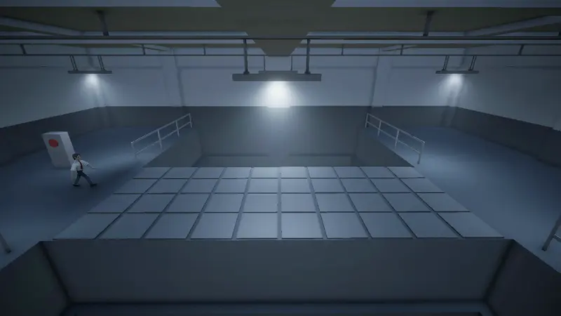
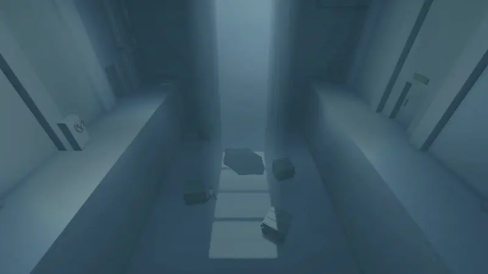
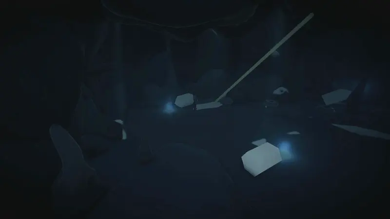

# DeadLine · Puzles de memoria, agua y luz

Cuatro salas jugables de *DeadLine*. [Descargar para Windows](https://github.com/shaw207/deadline-puzzles/releases/tag/v1.0.0)

Extrae el ZIP y abre `DeadLine-Original.exe`. Muévete con **WASD**, interactúa con **E** y cambia de sala con **F1–F4**. **Esc** cierra el juego.

<strong>F1 · Suelo de memoria</strong>

Tras un paso en falso, pulsa el botón para ver la ruta completa. Repite los 16 pasos para abrir la puerta.

<strong>F2 · Cajas flotantes</strong>

Empuja una caja en seco, pulsa **C** para volver al volante y usa **E** para elevar el agua.

<strong>F3 · Cinco cristales</strong>

Recoge cada cristal con **E** y lánzalo con el botón izquierdo hacia el pedestal que acepta su número.

**F4 · Tres válvulas.** En el juego, gira las válvulas para que los tres depósitos alcancen sus niveles a la vez.

## Proyecto y créditos

Abre [Memory](Assets/CompanyDay/Scenes/Memory.unity) o [WaterLight](Assets/CompanyDay/Scenes/WaterLight.unity) en Unity **6000.3.25f1**. Para usar el cielo original de Windows en *Memory*, importa el material `SkyhighFluffycloudField` de [Skybox Series Free](https://assetstore.unity.com/packages/2d/textures-materials/sky/skybox-series-free-103633) y asígnalo en **Lighting → Environment → Skybox Material**.

Chengxun Wu programó los puzles y Daniel Sánchez se encargó de la música y del diseño sonoro. El personaje, los modelos y los escenarios se usan con permiso del equipo de *DeadLine*. [Licencias](licenses)
